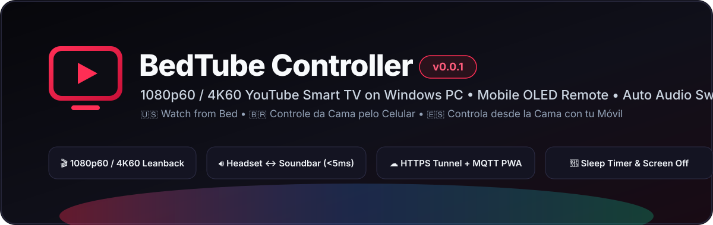

<div align="center">



<br/>

[](https://github.com/tprivmo-byte/bedtube-controller/releases/download/v0.0.2/BedTube-Setup-0.0.2.exe)
[-3f37c9?style=for-the-badge)](https://github.com/tprivmo-byte/bedtube-controller/releases/download/v0.0.2/BedTube-Portable-0.0.2-win64.zip)
[](LICENSE)

**Turn your Windows PC into a 1080p60 / 4K60 Smart TV controlled from bed with your smartphone — with automatic Headset ↔ Soundbar/TV audio switching, Screen Off/Wake, and Bedtime PC Shutdown.**

**Transforme seu PC Windows em uma Smart TV 1080p60 / 4K60 controlada da cama pelo celular — com troca automática de áudio Fone ↔ Soundbar/TV, Ligar/Apagar Tela e Desligamento do PC ao dormir.**

**Convierte tu PC Windows en un Smart TV 1080p60 / 4K60 controlado desde la cama con tu móvil — con cambio automático de audio Auriculares ↔ Barra de Sonido/TV, Encender/Apagar Pantalla y Apagado del PC.**

[**🇺🇸 English**](#-english) • [**🇧🇷 Português**](#-português) • [**🇪🇸 Español**](#-español) • [**🛠️ Build from Source**](#%EF%B8%8F-build-from-source-developers)

</div>

---

## 🆕 What's New in `v0.0.2` / Novidades da `v0.0.2` / Novedades `v0.0.2`

- **⏻ Shut Down PC When Tired (`Desligar PC quando cansar`):** Shut down Windows immediately from bed (with an 8-second cancelable safety countdown) or set a **Sleep-to-Shutdown Timer** (`15m`, `30m`, `60m`, `90m`). Before shutting down, BedTube automatically restores your **Headset / PC** default audio so your speakers never blast sound on next boot!
- **☀️ Dedicated Wake Screen Button (`Ligar Tela`):** Turned off your PC monitor to listen in the dark and want the screen back? Tap **`☀️ Ligar Tela` / `Wake Screen`** (or the instant top banner) — uses native Win32 `SendInput` + `SC_MONITORPOWER` to reliably wake Windows 10/11 monitors from Modern Standby.
- **✨ Redesigned Obsidian + Electric Indigo UI & 60fps Animations:** All-new sleek mobile remote & Desktop QR Pairing Hub featuring a 3D tactile Squircle D-Pad (`OK` indigo halo), thick 48px gradient pill volume slider with drag glow, GPU `translate3d` sliding segmented controls (`Soundbar / TV` ↔ `Fone / PC`, `1080p / Máx·4K / 720p / Auto`), staggered entrance cascade, and micro-haptic touch physics.

---

## 🇺🇸 English

### Why BedTube Controller?
If you use **headphones/headset** at your desk during the day, watching YouTube on your PC monitor or HDMI TV **from bed or the couch** is annoying: you have to get up to switch Windows audio outputs, lower loud desktop volume, grab a mouse, wake/turn off the screen, or get out of bed just to shut down the PC when sleepy.

**BedTube Controller** solves the entire bedroom/couch HTPC workflow in **one tap from your smartphone**:
1. **Wakes your PC screen** and opens **YouTube TV (Leanback Smart TV interface)** in an isolated fullscreen engine — **zero browser extension popups, zero desktop redirects, and unlocked 1080p60 / 1440p60 / 4K60 playback**.
2. **Automatically switches Windows default audio (`<5ms`)** from your **Headset/Headphones** to your **Soundbar / Speakers / HDMI TV** at a safe **Night Volume** (e.g., `25%`).
3. Gives your smartphone an installable **Animated OLED Touch Remote (PWA)** with tactile 3D Squircle D-Pad, instant text or YouTube URL search, GPU sliding `1080p / 4K / 720p / Auto` quality switcher, pill volume slider, **Turn Off / Wake PC Monitor**, **Sleep Timer**, and **PC Shutdown when tired**.
4. **Watchdog Auto-Restore:** Whether YouTube TV closes from your phone, `Alt+F4`, gamepad, Sleep Timer, or before a scheduled **PC Shutdown**, Windows audio **automatically reverts to your Headset**.

### ✨ Key Features (`v0.0.2`)
- **🎬 Unlocked 1080p60 & 4K60 YouTube TV on Windows:** Isolated Electron Smart TV shell with Cobalt 27 / Starboard MSE profile and GPU hardware video decoding.
- **🔊 Instant Native CoreAudio Switcher (`<5ms`):** Direct Windows `IPolicyConfig` COM + `pycaw` endpoint switching across Multimedia, Console, and Communications roles — zero PowerShell popups or virtual audio drivers.
- **☀️ Screen Off & Instant Wake + ⏻ Bedtime PC Shutdown:** Turn off the monitor while audio keeps playing, wake it back up in one tap (`SendInput` hardware wake), or schedule/trigger full Windows shutdown from bed.
- **☁️ Works When PC is on Wired Ethernet & Phone is on Wi-Fi:** Built-in **Cloudflare HTTPS Quick Tunnel** + **HMAC-SHA256 Encrypted MQTT Relay**. Automatically bypasses router AP/LAN isolation and Android 15/16/17 Local Network blocks with zero port-forwarding.
- **📲 Reboot-Proof Mobile PWA & 60fps Gamepad Support:** Install to iPhone/Android Home Screen once; also works out of the box with Xbox & PlayStation controllers.
- **🪄 Custom Dark-Mode Installer (`BedTube-Setup-0.0.2.exe`):** Fast native WPF installer & uninstaller in English, Portuguese, and Spanish — no Admin/UAC prompt required.

### 🚀 Quick Start (Windows 10 / 11 x64)
1. Download **[`BedTube-Setup-0.0.2.exe`](https://github.com/tprivmo-byte/bedtube-controller/releases/download/v0.0.2/BedTube-Setup-0.0.2.exe)** (or the portable `.zip` from [Releases](https://github.com/tprivmo-byte/bedtube-controller/releases/tag/v0.0.2)).
2. Run the setup wizard and click **Install**.
3. In the **BedTube Pairing Hub** that opens automatically, choose your **TV / Soundbar** audio device and your **Headset / Desk** audio device, then scan the **QR Code** with your phone camera!

---

## 🇧🇷 Português

### Por que usar o BedTube Controller?
Quem usa **fone de ouvido (headset)** no computador sabe o incômodo que é deitar na cama para assistir YouTube no monitor ou na TV HDMI: levantar para trocar a saída de som do Windows, abaixar o volume, ficar sem botão para **religar a tela depois de apagá-la** ou ter que levantar quando bate o sono só para **desligar o PC**.

O **BedTube Controller `v0.0.2`** resolve tudo com **1 toque no celular**:
1. **Acorda o monitor** e abre o **YouTube TV (interface oficial de Smart TV)** em tela cheia totalmente isolada — **sem janelas de extensões e com qualidade destravada em 1080p60 / 1440p60 / 4K60**.
2. **Troca automaticamente o som do Windows em `<5ms`** do seu **Fone/Headset** para a **Soundbar / Caixa de Som / TV HDMI** já ajustada no **Volume Noturno** ideal (ex: `25%`).
3. Transforma seu celular em um **Controle Remoto OLED Animado (PWA)** com D-Pad Squircle 3D tátil, busca rápida, slider espesso de volume, pílulas deslizantes a 60fps (`Soundbar/TV ↔ Fone/PC`, `1080p / Máx·4K / 720p / Auto`), botões dedicados **Apagar Tela** e **☀️ Ligar Tela**, **Sleep Timer** e **⏻ Desligar PC quando cansar** (`Agora` ou em `15 / 30 / 60 / 90 min`).
4. **Watchdog Inteligente:** Fechou a TV ou mandou desligar o PC? O áudio do Windows **volta sozinho para o Fone de Ouvido** antes de encerrar.

### 🚀 Instalação Rápida (Windows 10 / 11 x64)
1. Baixe o **[`BedTube-Setup-0.0.2.exe`](https://github.com/tprivmo-byte/bedtube-controller/releases/download/v0.0.2/BedTube-Setup-0.0.2.exe)** (ou a versão portátil `.zip` em [Releases](https://github.com/tprivmo-byte/bedtube-controller/releases/tag/v0.0.2)).
2. Execute o instalador e clique em **Instalar BedTube Controller v0.0.2**.
3. Na central de QR Code que abrirá automaticamente, escolha sua **Soundbar / Caixa de Som / TV** e seu **Fone de Ouvido**, salve e escaneie o **QR Code** com a câmera do celular!

---

## 🇪🇸 Español

### ¿Por qué usar BedTube Controller?
Si usas **auriculares (headset)** en el escritorio, ver YouTube en el monitor de tu PC o TV HDMI **desde la cama o el sofá** suele ser incómodo: levantarse para cambiar el audio de Windows, bajar el volumen, volver a encender el monitor tras apagarlo o levantarse con sueño para apagar la computadora.

**BedTube Controller `v0.0.2`** automatiza todo con **un solo toque desde tu móvil**:
1. **Enciende el monitor** y lanza **YouTube TV (Smart TV Leanback)** a pantalla completa en un motor aislado con **1080p60 / 1440p60 / 4K60 desbloqueados**.
2. **Cambia automáticamente el audio de Windows en `<5ms`** de tus **Auriculares/Headset** a tu **Barra de Sonido / Altavoces / TV HDMI** con **Volumen Nocturno** seguro.
3. Convierte tu smartphone en un **Control Remoto OLED Animado (PWA)** con cruceta D-Pad 3D, búsqueda rápida, control deslizante de volumen, **Apagar Pantalla** + botón dedicado **☀️ Encender Pantalla**, **Temporizador** y **⏻ Apagar PC al cansarte** (`Ahora` o en `15 / 30 / 60 / 90 min`, restaurando tus auriculares antes de apagar Windows).

### 🚀 Instalación Rápida (Windows 10 / 11 x64)
1. Descarga **[`BedTube-Setup-0.0.2.exe`](https://github.com/tprivmo-byte/bedtube-controller/releases/download/v0.0.2/BedTube-Setup-0.0.2.exe)** (o el archivo portátil `.zip` en [Releases](https://github.com/tprivmo-byte/bedtube-controller/releases/tag/v0.0.2)).
2. Abre el instalador y haz clic en **Instalar BedTube Controller v0.0.2**.
3. Selecciona tu **Barra de Sonido / Altavoces / TV** y tus **Auriculares**, ¡y escanea el **Código QR** con la cámara de tu celular!

---

## 🛠️ Build from Source (Developers)

```powershell
# 1. Install Python dependencies (Windows 10/11, Python 3.10+)
pip install -r requirements.txt

# 2. Run directly from source and open the Pairing Hub
python bedtube.pyw --show-qr

# 3. Build standalone BedTube.exe + Portable ZIP + Custom WPF Installer (BedTube-Setup-0.0.2.exe)
#    (Place cloudflared.exe in .\bin\cloudflared.exe and Electron runtime in .\runtime\electron\)
python build_release.py
```

### Architecture Overview
| Module | Responsibility |
| :--- | :--- |
| `bedtube.pyw` | System Tray daemon (`pystray`), single-instance mutex, High-DPI awareness & waitress HTTP host |
| `audio_manager.py` | Native Windows CoreAudio `IPolicyConfig` COM endpoint switching (`<5ms`) + `pycaw` volume/mute |
| `tv_manager.py` | Electron Smart TV lifecycle, Watchdog audio restore, Win32 `SendInput` monitor wake/off & PC Shutdown scheduler |
| `tv_shell/` | Isolated YouTube TV Leanback shell with Cobalt 27 `1080p60/4K60` MSE unlocker & 60fps Gamepad engine |
| `cloud_bridge.py` | Zero-config `cloudflared` HTTPS tunnel + Win32 Job Object + HMAC-SHA256 MQTT TLS Relay |
| `web_app.py` | Trilingual (`EN/PT/ES`) Animated Mobile OLED PWA Remote + Desktop QR Pairing & Audio Hub |
| `installer/` | Native C# WPF Custom-UI Self-Extracting Installer (`Setup.cs`) & Uninstaller (`Uninstaller.cs`) |

---

## 🔎 Search Keywords / Palavras-chave / Palabras Clave

- **English:** youtube tv on pc, youtube leanback windows 11, youtube tv 1080p 60fps 4k desktop, unlock 1080p youtube tv browser, control pc youtube from phone, smartphone remote control for windows pc, watch youtube from bed on pc, couch htpc remote pwa, automatic audio output switcher windows, switch headphones to speakers automatically, headset to soundbar switcher, turn off and wake pc monitor from phone, shutdown pc from phone bed timer, windows sleep timer remote app, youtube tv gamepad controller windows.
- **Português:** youtube tv no pc, youtube de smart tv no windows 10 11, youtube tv 1080p 60fps 4k pc, destravar 1080p youtube tv navegador, controlar youtube do pc pelo celular, controle remoto para pc pelo celular wifi, assistir youtube deitado na cama no pc, transformar pc em smart tv, trocar saida de audio automaticamente windows, alternar fone de ouvido e caixa de som sozinho, trocar headset para soundbar automatico, apagar e ligar tela do monitor pelo celular, desligar pc pelo celular quando dormir cansar, timer desligamento pc cama, youtube tv controle xbox playstation pc.
- **Español:** youtube tv en pc, youtube de smart tv en windows 10 11, youtube tv 1080p 60fps 4k escritorio, desbloquear 1080p youtube tv pc, controlar youtube de pc desde el celular movil, control remoto mando a distancia para pc desde el telefono, ver youtube desde la cama en pc, convertir pc en smart tv, cambiar salida de audio automaticamente windows, alternar auriculares y altavoces automaticamente, cambiar headset a barra de sonido, apagar y encender pantalla del monitor desde el movil, apagar pc computadora desde el celular cama temporizador, mando xbox playstation youtube tv pc.

## 📄 License
Distributed under the [MIT License](LICENSE).
